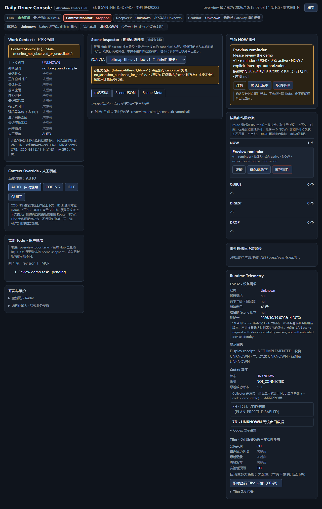
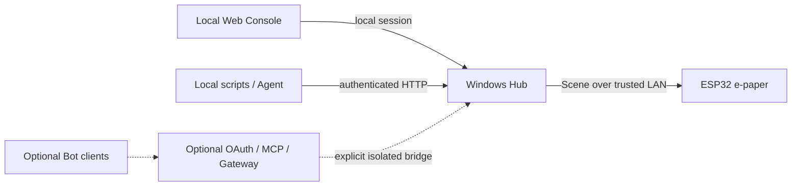

# Attention Router

**中文** | [English](README_EN.md) | [English installation](docs/INSTALL_EN.md)

**v0.1.0 · 源码发布**

A local-first AI attention router powered by ESP32 e-paper, bringing tasks, work context, and important alerts into focus.

Attention Router 是基于 ESP32 墨水屏的本地优先注意力路由器：将任务、工作上下文和重要提醒放到桌面，让你知道现在做什么、哪些事情需要回应。也可以先单独运行 Web Console，无需硬件、Bot 或模型订阅。它是 Personal Agent 在物理世界的注意力交互终端；当前由确定性规则路由，并未实现通用 Agent 生命周期管理。

当工作分散在浏览器、编辑器与 Agent 会话中，桌面屏幕提供一个稳定的入口：Home 看待办，Workspace 保留当前事项，Interrupt 显示得到授权的提醒。任务与提醒确认分开处理，避免一次 ACK 被误当成工作已经完成。

> **v0.1.0 已发布，提供源码，不提供预编译固件。** 发布基线 `3ba371af` 的[有限 GitHub Actions 检查已通过](https://github.com/Tkkdy/attention-router/actions/runs/39403342507)；这不代表全量回归或最终真机验收通过。精确公开固件的最终硬件验收及实拍仍待完成，详见[验证记录](docs/VALIDATION.md)。

## 真实界面与系统关系



上图由当前候选的隔离 Hub 与真实浏览器渲染，使用合成数据、关闭前台监控；不是 Mock 界面，也不证明设备已连接或真机验收通过。安全可公开的 ESP32 实拍尚缺，待补充，不以概念图替代实物照片。素材来源与隐私处理见 [素材索引](assets/ASSET_INDEX.md)。



图中实线是基础路径，虚线是实验集成；远程 OAuth/MCP 与本地 Gateway 不是自动安装的一体服务。设备实际定期拉取 `/scene`。可维护图源见 [architecture.mmd](assets/architecture.mmd)。

## 已实现的核心能力

`Implemented` 表示源码与相应软件验证存在，不代表最终候选所有硬件行为已验收。

| 能力 | 实际行为 |
| --- | --- |
| Home / Workspace / Interrupt | 空闲页、工作页、授权提醒覆盖页；最终页面受 Router 与可选页面生命周期共同决定 |
| Todo / Current / Next | 有序待办、显式当前事项、排除当前项后的下一批任务；不是自动识别 Agent 工作成果 |
| Windows 工作上下文 | 前台应用信号、工作会话阈值、AUTO/CODING/IDLE/QUIET 手动覆盖 |
| NOW / QUEUE / DIGEST / DROP | 决定立即显示、等待、保存为非打断信息、撤回注意力；同时最多一个 NOW |
| Web Console 与 ACK | 查看上下文、路由、任务、提醒及来源；确认提醒不完成 Todo |
| 本地集成与局域网 Scene | 本地鉴权 HTTP API；ESP32 定期读取 Scene，Hub 发布状态与设备显示回执分开 |
| 断连降级与恢复逻辑 | 默认约 90 秒失联后降级，连接稳定约 45 秒恢复；STALE 明示旧数据，中文离线缓存有限制 |

**Today 的确切含义：** Home 的 `TODAY` 是界面分区名，取现有顺序中前 3 个 `pending` Todo，**不按今日或到期日过滤，也不按时间自动完成任务**。Workspace 的 Next 先按 ID 排除 Current，再取前 3 个待办。同名且不同 ID 的任务仍是不同事项。部分日期适配器采用 UTC+8，尚非全面时区本地化。

**路由不是 LLM 摘要：** 未到时间的事件排 QUEUE；明确授权的提醒/当前阻塞可进 NOW；等待的结果在 CODING/QUIET 时延后；无打断授权的信息进入 DIGEST；确认、取消或过期事件可进 DROP。DIGEST 是保存/分类，不是已经实现的自动摘要产品。

## 实验能力与计划

以下功能都实际有代码，但属于 **Experimental**，基础安装不依赖它们：

- **GrokBot、MCP/OAuth**：本地 MCP 读取与受策略控制的 Todo/Current 写入；远程 OAuth 库、Gateway 接入和客户端工具合约。需自有账号、鉴权及单独部署，未完成独立 Bot 一键安装验收。
- **DeepSeekBot、自然语言 Resolver**：外部 DS Bot/Harness 适配器；隔离 Todo Core 的增改、完成、删除、排序、Current、建议及提醒桥接；自然语言解析仅支持配置的官方 DeepSeek 在线 API，可能计费，会发送所需用户输入与业务快照。不是免费本地开源权重推理。
- **Todo Core / Gateway / 投影桥接**：隔离任务域、修订冲突与幂等控制；不会因启动 Gateway 自动同步基础 Hub，更不代表生产 Todo 迁移已经完成。
- **Codex 额度**：可选读取已登录本机 Codex app-server 的额度快照；基础启动入口默认不启用，不观察工作完成或审批状态。
- **Tibo Reset**：可选社区 Reset 状态/预测及设备详情页，默认关闭，自动注意力策略尚未配置，不保证未来重置。
- **Radar、天气、NTP、Internet Probe**：可配置的 Hub/设备外部来源，默认基础配置不要求启用；设备外网探测成功不等于 LAN Hub 新鲜，反之亦然。

[完整双语功能矩阵与 Roadmap](docs/FEATURES.md) 逐项列出入口、依赖、费用与验收边界。**Planned**：ChatGPT 网页回答结束提醒、Codex 完成/待批准/待验收提醒、Agent Inbox、更广个人上下文与注意力管家；这些尚未实现，不承诺日期。

## 先在 Windows 运行

在全新解压目录打开 PowerShell。历史软件验证使用 Windows、Python 3.13.7；依赖锁文件在包内：

```powershell
py -3.13 -m venv .venv
.\.venv\Scripts\python.exe -m pip install -r requirements.lock.txt
Copy-Item config.example.json config.local.json
.\.venv\Scripts\python.exe hub\run_preview.py
```

打开 <http://127.0.0.1:8765/>。默认仅监听本机，不安装系统服务，不要求域名、Tunnel、Bot 或模型订阅。数据保存在本目录 `.build/preview-data/`；不要复制私人旧数据库。停止用该终端 `Ctrl+C`，再次运行同一命令会复用该目录数据。

另开终端，创建合成示例 Todo、Current 和提醒：

```powershell
.\.venv\Scripts\python.exe examples\local_demo.py
```

在 Console 点击 ACK，确认提醒消失且 Todo 未被误标完成。手动 CODING 可提供工作上下文输入；自动模式默认需要连续强信号 120 秒进入工作会话，900 秒无强信号退出。它不识别 Agent 是否已完成任务。演示会写入新安装数据，仅在隔离目录运行。

### 用普通 Agent 接入

在**全新隔离安装**中，启动 Hub 时加 `--api-token-prompt`，私密输入自己的 32+ 字符随机 Token；另开终端运行：

```powershell
.\.venv\Scripts\python.exe examples\agent_http_demo.py
```

输入相同 Token（不回显）。示例依次读取 revision、创建合成 Todo、用其真实 ID 设置 Current、发布明确授权的合成提醒，再验证 ACK 不完成 Todo。网络重试保留原请求，409 会重读修订号后停止；仅连接 `127.0.0.1`，拒绝私人 8000 端口。完整两终端命令与安全边界见 [Agent HTTP 上手](docs/AGENTS.md#agent-http-quickstart)。不需要 GrokBot、DeepSeekBot、OAuth、Tunnel 或收费模型。原 Cookie 演示 `local_demo.py` 仍可使用。

`config.local.json` 支持 `port`、`device_host`、`monitor`。端口占用时换端口，不停止别人的服务；示例同时加 `--url http://127.0.0.1:新端口`。完整依赖、启停、固件构建和排查见 [Windows 安装指南](docs/WINDOWS.md)。

## 指定硬件与固件

首发目标仅经典 ESP32（4 MB Flash 构建目标）+ **GDEY042Z98，4.2 英寸，400×300，黑白红，SSD1683** 及匹配转接板。不同的“4.2 寸”不能直接替换；Seeed XIAO ESP32S3 属后续支持。实物板卡、转接板、供电与接线仍须在最终安全验收中确认。

按 [HARDWARE](docs/HARDWARE.md) 核实接线和电压；ESP32 GPIO 使用 3.3 V 逻辑，转接板能否接受 5 V 不能从源码推断。复制 `firmware/esp32_dashboard/private_config.example.h` 为同目录 `private_config.h`，仅填自己的测试 Wi-Fi/Hub 设置。官方工具链为 Arduino CLI 1.5.1、ESP32 Core 3.3.1、GxEPD2 1.6.9、ArduinoJson 7.4.2、Adafruit GFX 1.12.6 / BusIO 1.17.4；具体安装和只编译命令见 [WINDOWS](docs/WINDOWS.md)。

设备与 Hub 在可信 LAN 中；将 `device_host` 设为电脑指定私有 IPv4，固件地址使用相同 IP/端口，重启的只应是自己的隔离 Hub。防火墙按需手工限制到设备来源，不自动修改。构建产物可能包含 Wi-Fi 凭据，禁止公开 `.build`、`private_config.h` 或个人 `.bin`。

首次硬件尝试请使用经所有者确认的兼容测试设备；现有设备写入前须验证应用与必要数据的完整回退，**仅恢复应用不恢复 NVS**。作者原板的 No-Go 限制和具体安全门槛保留在[硬件说明](docs/HARDWARE.md)及[英文安装指南](docs/INSTALL_EN.md)。预编译固件仍待安全配置与指定硬件验收完成。

## 网络、安全与已知限制

- 默认本机 Console 使用本地 Cookie；写请求受同源检查。匿名 LAN 仅可读 `/scene`、`/health`，但 Scene 本身包含任务信息。
- 使用 `--api-token-prompt` 可在私密提示中提供 32+ 字符 ASCII 无空白 Bearer token；正确 Bearer 在已绑定 LAN 上也能调用管理 API，**不是仅限 loopback**。明文 HTTP 不保护令牌，建议 Agent 使用本机地址。不要把 Hub/Gateway/数据库直接公开到 Tunnel。
- 私人运行版本曾观察到失联降级与自动恢复；当前运行固件身份 UNKNOWN。最终候选尚无精确二进制真机闭环，长期可靠性未证明。
- 私人设备离线冷启动曾显示 `Todo <短 ID>` ASCII 备用标题，联网后原标题恢复；历史也出现 NVS 写入失败。根因未闭环，不能断言候选默认路径必现，也不保证中文离线无损恢复。该项可作为后续 Issue，原板诊断冻结。
- 微软雅黑不随包分发；没有可用字体时中文位图降级为 ASCII。`/scene` 成功只表示响应已准备，不证明屏幕显示完成。默认设备轮询约 30 秒、HTTP 读取超时 5 秒；不是紧急安全提醒系统。
- 已有稳定性测试 9/9；核心回归 86/88，两项旧 JSON 迁移失败保留；仅支持新数据目录。长事务故障注入下业务接口仍会超时，不能仅凭健康接口正常认定设备路径正常。
- 设备 NTP/天气/Radar 要求 Internet Probe 配置且成功；探测 URL 留空时不会启动新的对应获取。基础 Hub 任务不依赖这些外网来源。

详情：[已知限制](docs/LIMITATIONS.md)、[验证记录](docs/VALIDATION.md)、[网络边界](docs/NETWORK.md)。上述历史证据不替代精确公开固件的有限核心硬件验收；该项作为后续工作，不阻止本次源码发布。

## 文档、贡献与许可

- [English README](README_EN.md) · [完整功能与 Roadmap](docs/FEATURES.md)
- [Windows 安装](docs/WINDOWS.md) · [硬件与接线](docs/HARDWARE.md)
- [Agent 接入](docs/AGENTS.md) · [网络部署](docs/NETWORK.md)
- [限制](docs/LIMITATIONS.md) · [验证](docs/VALIDATION.md)
- [贡献指南](CONTRIBUTING.md) · [Release Notes](RELEASE_NOTES.md)
- [许可证范围](docs/LICENSING.md) · [第三方通知](THIRD_PARTY_NOTICES.md)

欢迎通过 Issues 报告问题和提出功能建议，也接受 Pull Requests；暂不启用 Discussions。公开仓库：[Tkkdy/attention-router](https://github.com/Tkkdy/attention-router)。

Copyright (c) 2026 Tkkdy。独立原创 Hub、Console 和工具采用 **MIT**；ESP32 固件原创部分采用 **GPL-3.0-only**，组合依赖遵守各自适用义务；第三方保留原许可。两者均允许商业使用，不能以根目录 MIT 覆盖固件 GPL 范围。完整条款以许可文件为准。
