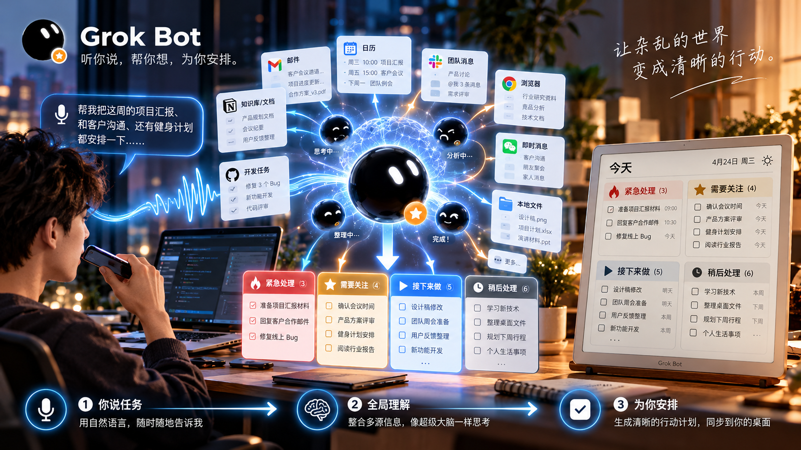
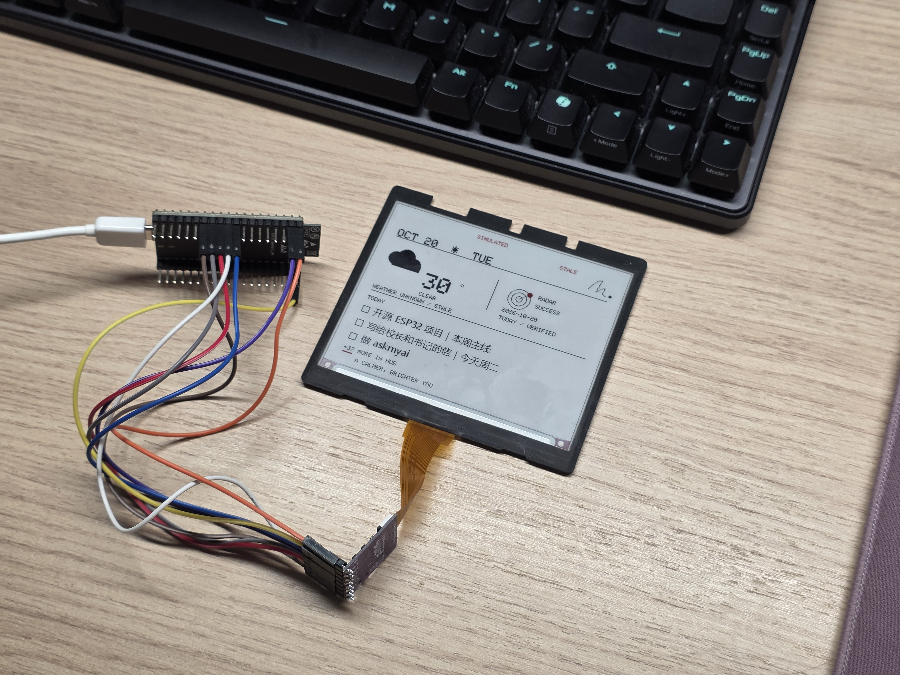
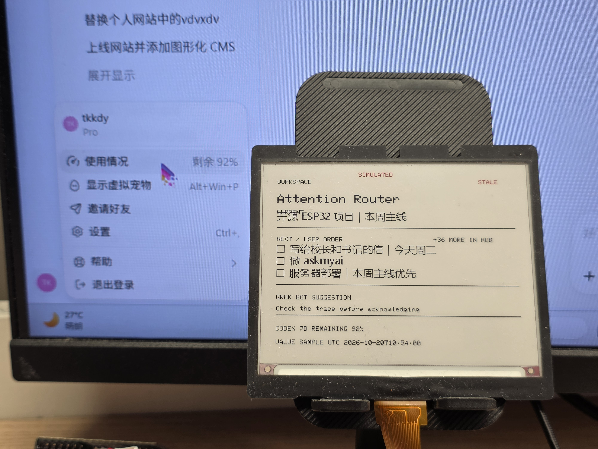
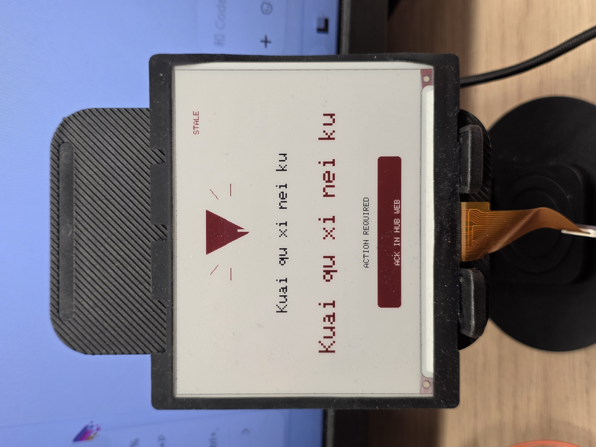
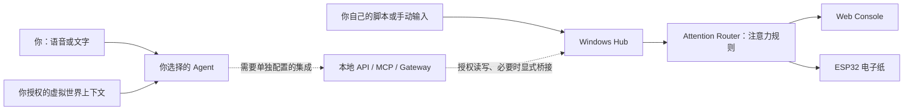
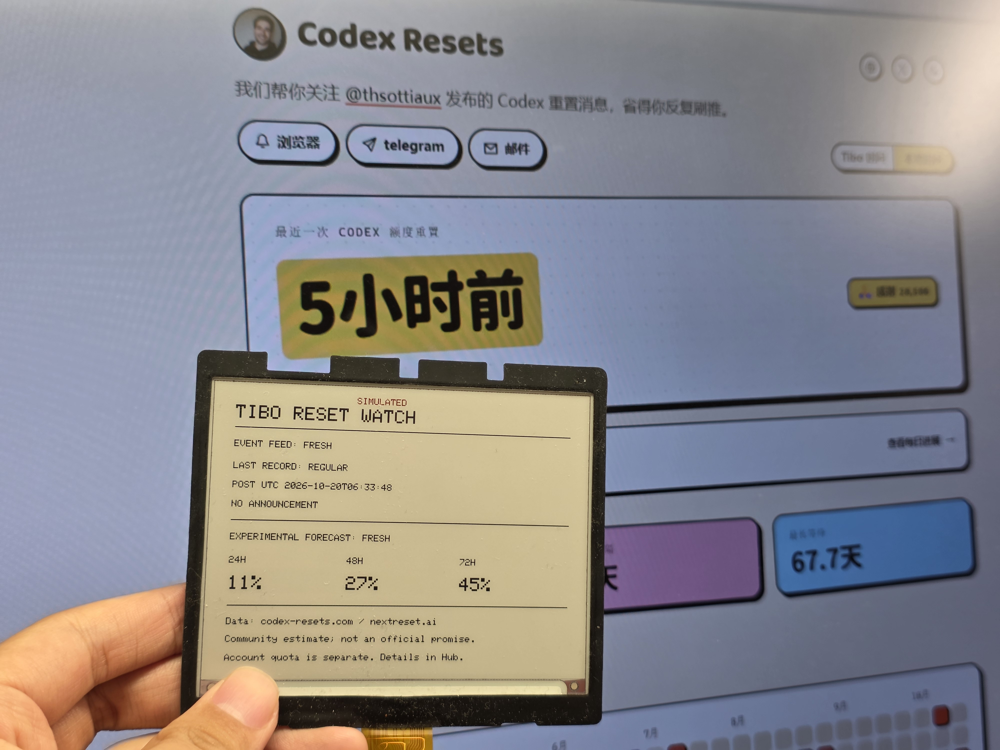

# Attention Router · 注意力路由器



*项目概念展示图：表达 Agent 整理信息、通过桌面终端主动联系你的方向；图中的多源连接器与完整工作流并非都已实现。*

> **你已经有了自己的 AI，现在给它一个主动联系你的方式。**
>
> **Attention Router 是 Agent 的 Attention I/O。**

[English](README_EN.md) · [五分钟体验](#五分钟先体验不需要硬件) · [接入自己的-agent](#bring-your-own-agent让你的-ai-自己接进来) · [硬件指南](docs/HARDWARE.md) · [功能与 Roadmap](docs/FEATURES.md) · [v0.1.0 源码发布](https://github.com/Tkkdy/attention-router/releases/tag/v0.1.0)

我们已经习惯用手机、电脑和 AI 说话：告诉它今天要做什么、正在忙哪个项目、下一步准备怎么办。AI 知道的事情越来越多，但当它想提醒你时，你通常还是得**自己打开聊天窗口，主动去找它**。

我想把这个过程反过来。

给 AI 一块属于它自己的桌面电子纸，让它能够把你真正需要关注的事情带到现实世界。它可以静静地待在键盘或鼠标旁边，不占用手机，也不占用电脑屏幕。你抬头看一眼，就知道现在应该把注意力放在哪里。

**Attention Router（注意力路由器）** 就是我为这件事做的开源项目：它连接你选择的 Agent、任务与工作上下文，再通过一套注意力路由规则，把当前事项、下一步工作和获得授权的重要提醒展示在独立的 ESP32 电子纸上。

我希望它最终能成为我的虚拟管家通往现实世界的一扇门。以前总是我去找 AI，现在，也该轮到 AI 来敲敲门了。

> **关于现在的完成度：** 目前发布的是 **v0.1.0 源码版**。任务、工作场景、确定性注意力路由、Web Console 等基础软件能力已有实现；GrokBot、DeepSeekBot、Tibo、Codex 额度等属于需要单独配置的实验集成；跨应用主动感知生活、自动预测个人事项等是未来方向。**精确公开候选固件的最终真机验收尚未完成，不提供通用预编译固件。** 以下会把三者明确区分。

## 先看看它现在的样子



<table>
<tr><th>Workspace · 当前事项与下一步</th><th>Interrupt · 等待手动确认</th></tr>
<tr><td></td><td></td></tr>
</table>

*以上为真机实拍，保留屏幕上的 `SIMULATED` / `STALE` 标记；展示原型页面，不表示精确公开候选固件已完成最终真机验收。*

<details>
<summary>查看 Web Console</summary>


*这是真实运行的 Web Console 截图，数据是隔离环境中的合成示例，不是电子纸实拍。*

</details>

## 让 AI 主动来找你：它是怎么工作的？

想象一下，你拿起手机，和自己的 AI 说：

> “帮我记一下：今天继续做 Attention Router，明天要看项目进展；还有，晚上记得提醒我洗衣服。”

**待办来自你自己告诉 AI 的事情，或者你明确授权它参考的记录，不是设备凭空编出来的。** 如果 Agent 有足够的上下文，它还可以帮你整理、排序、提出建议；再把确认后的任务和授权提醒传给 Attention Router。至于哪些事情需要你亲自处理、什么时候该打断你，则由 Agent 的判断、你的授权和 Router 的规则共同决定。



这里有三个不同的角色：

- **你的 Agent 负责理解你。** 可以是 GrokBot，也可以是你自己的 AI。它能参考什么上下文，取决于你给它的工具、权限和实际接入的来源。
- **Attention Router 负责安排信息怎么出现。** 任务、当前工作状态和事件进入 Hub，路由器根据授权、时间及工作状态决定哪些信息现在值得提醒。
- **电子纸负责把信息带到眼前。** 它不是一块用来继续聊天的手机屏幕，而是 Agent 在桌面上独立、低干扰的输出窗口。

**当前基础 Hub 不会自动从所有软件里读取你的历史，也不会自己理解完整生活。** 上面的“语音 → 多源上下文 → 智能安排”是一种可通过外部 Agent 逐步搭建的体验，完整通用管家尚未实现。

## 现在已经可以用它做什么？

### 1. Home：每天抬头看一眼

基础 Home 页面可以展示待办与当前状态。你可以给 AI 提供任务，再通过明确配置的 Agent 集成或本地接口将它们写入 Hub，让桌面始终有一份清楚的事情列表。

**一个容易误解的细节：** 目前页面上的 `TODAY` 指**现有排序中前三条未完成 Todo**，还不是自动按日期/截止时间筛选的“今天到期事项”。我希望未来把它变成更聪明的每日安排，但不会把还没实现的功能算进去。

### 2. Workspace：我现在到底在推进什么？

正在写代码、改项目、研究资料，任务很容易被新的窗口和消息打断。Workspace 可以展示：

- **Current：** 你明确设置的当前事项。
- **Next：** 排除当前事项后，接下来准备处理的待办。
- **工作上下文：** Windows 前台应用的部分工作信号，以及 `AUTO / CODING / IDLE / QUIET` 状态或手动覆盖。

Agent 也可以通过适配接口提供建议或更新当前事项，但**现有系统不会自动识别任意 Agent 已经完成了什么工作**；建议来自哪个 Agent、是否可信，仍需要按来源与权限处理。

### 3. Interrupt：重要的事情，AI 可以主动来提醒

这也是我最想做好的地方：**AI 要知道什么时候该说话，什么时候不该说话。**

现在已经有 Interrupt 提醒页面，以及 `NOW / QUEUE / DIGEST / DROP` 四类路由结果：

| 路由 | 它意味着什么 |
| --- | --- |
| **NOW** | 有权限、值得当前提醒的事件；同一时刻最多呈现一个 |
| **QUEUE** | 还没到时间，或当前不适合打断，先排队 |
| **DIGEST** | 留下信息，但不主动打断；目前是路由分类，**不是**已经完成的 AI 自动摘要 |
| **DROP** | 事件已取消、已确认或失效，不再占用注意力；**不等于删除 Todo** |

比如你正在 CODING 或 QUIET，一些等待结果类事件可以先进入队列；真正得到授权的提醒才有机会成为 Interrupt。提醒看过后，在 Web Console 点击 **ACK** 只表示“知道了”，不会误把待办标成“已完成”。

至于我想让它以后提醒什么？其实很生活化：

> “你今天内裤洗了没有？再不洗就要睡觉了。”
>
> “外卖快到了，该下去拿了。”
>
> “快递到了，路过驿站可以顺便取。”
>
> “社区洗衣机马上洗好，记得下楼收。”

这些很有趣，但**外卖、快递、洗衣机等自动信息源目前并未原生接入**。现阶段可以通过已有的授权事件 API 演示提醒机制，真正自动获取这些生活事件还需要后续集成。

### 4. 自己喜欢的小功能与实验模块

我还把一些自己天天用、觉得有意思的东西尝试接进了这个项目。以下都属于**可选实验能力**，不代表默认安装就全部启用：

| 功能 | 现在能做到什么 | 需要注意的边界 |
| --- | --- | --- |
| **Morning Radar / 晨报状态** | 可从自定义来源读取晨报状态，并用于 Hub 或设备上的展示 | 需要配置你自己的 Radar 状态服务；仓库不包含完整晨报生产系统，也不等于自动读取任意 GitHub Actions 运行结果 |
| **Codex 额度** | 可选读取本机已登录 Codex app-server 的额度快照与时间窗口 | 默认预览入口不启用；额度信息不代表 Codex 的任务完成或等待审批状态 |
| **Tibo Reset** | 可选社区重置状态、预测、60 秒手动详情与阈值自动页 | 默认关闭；新鲜的 24 小时概率严格大于阈值（默认 70%）时触发，保持到手动关闭；预测不是官方保证 |
| **天气 / NTP** | 在配置网络、地区等条件后，支持相应天气与时间信息 | 离线或来源失败时可能显示旧信息/UNKNOWN |
| **GrokBot / DeepSeekBot** | 已有经过开发和一定验证的实验性接口、适配器、Gateway 相关代码 | 需要用户自己的 Bot、权限、配置和独立环境；并非两者都已经实现一键安装闭环 |

一个我很喜欢的 Tibo 彩蛋是：**接近预测重置时，电子纸主动展示重置详情，让你想起：“额度快重置了，要不要先把这轮用完？”** 当前已有可选的概率阈值自动页；需在 Console 单独启用，活动提醒仍优先。社区预测不保证重置，也不代表个人额度。



*实拍中的日期、概率及 `SIMULATED` 标记原样保留，仅展示页面，不是当前重置消息。*

## 我接下来还想做什么？

我希望 Attention Router 越来越像一个真正懂你生活的管家，而不只是显示待办的小设备。方向包括：

- **让 Agent 能主动告诉你工作结束了。** 比如 ChatGPT 网页回答完成、Codex 任务完成、等待授权或等待人工验收时，屏幕出现一张恰当的提醒卡片。**尚未实现通用自动检测。**
- **给 Agent 一个 Inbox。** 将多个 Agent 的结果、需要确认的事项，以及下一步需要你做的决定整理到一起。**规划中。**
- **通过 MCP 等工具获取更多你授权的手机上下文。** 我设想未来 Agent 能在取得许可并有可用工具的条件下读取生活事件，例如外卖、快递、洗衣机状态，再决定是否提醒。**只是方向，尚无跨手机平台的通用实现，也不承诺可以读取任何 App。**
- **更聪明地预测下一步。** 如果 Agent 已经了解你过去的项目与日常安排，它可以根据有来源的记录提出“你明天可能需要处理这个”的建议，降低遗忘概率。**这是 Agent 能力与未来集成目标，不是 v0.1.0 的自动预测功能。**
- **更丰富的页面和硬件。** 把工作状态、自己的项目、其他来源乃至新的电子纸型号都做成可以扩展的体验。

这些方向没有承诺发布日期。我更希望一步步把真正有价值的使用场景做出来，也欢迎社区告诉我有哪些功能值得先做。

## Bring Your Own Agent：让你的 AI 自己接进来

**不需要跟我一样使用 GrokBot，也不需要为了体验基础 Hub 去购买某个 AI 订阅。**

我把这套东西开源，就是希望你能用自己的 Agent、自己的脚本、自己的模型与工作流，给它们一个主动联系你的物理出口。

你甚至可以把仓库交给自己常用的编码 Agent，让它阅读[接入文档](docs/AGENTS.md)与[功能矩阵](docs/FEATURES.md)，帮你研究如何连接。一个合理的接入顺序是：

1. **先在隔离的新目录启动 Hub**，打开 Web Console，不接私人生产数据。
2. **先用本地 API 跑通一个 Todo 和一个授权提醒**，确认在 Console 中能正确显示，ACK 不会把 Todo 标成完成。
3. **再选择接入方式**：本地 HTTP、实验性 MCP 工具，或者按要求配置 GrokBot / DeepSeekBot 适配器。
4. **最后再连接实体电子纸**，核对指定硬件、电压、网络与实际屏幕表现。

接入 Agent 时可以让它先读仓库、给方案、在测试环境动手，**但不要把私有 Token、Wi-Fi 密码、私人任务数据库贴进聊天，也不要把 Hub/Gateway 直接暴露到公网**。没有完成测试前，也不要让 Agent 修改你的现有日常任务。

> **实际接入边界：** 基础 Hub 可被本地脚本/API 使用，且本身不调用 LLM；本地 MCP 有额外安装及读写授权策略；GrokBot 远程 OAuth、DeepSeekBot/Harness 的完整干净环境安装仍属实验集成，不是把仓库链接发给所有 AI 就一定能自动装好的功能。

## 你想怎么改，就怎么改

我提供的只是一个起点，不希望所有人都用和我一模一样的桌面。

- 觉得现有页面不好看？欢迎重新设计自己的 **Scene / 页面布局**。
- 不需要我的 Morning Radar？可以接入**你自己的项目进度、状态、任务或信息源**。
- 你想让 AI 在新事件发生时提醒你？可以尝试贡献**新的事件来源、路由规则与提醒卡片**。
- 你用的不是 GrokBot？欢迎给**新的 Agent 或 MCP 客户端**做适配。
- 有其他 ESP32、电子纸或你自己做的外壳？欢迎研究新的**硬件适配**。

这些扩展有些需要修改 Hub、固件或接口，不是所有模块都有现成的插件按钮。但源码和相关文档公开了，你完全可以从自己的需求出发继续做。

**有想法就提 [Issue](https://github.com/Tkkdy/attention-router/issues)，发现 Bug 可以反馈，愿意开发就发 [Pull Request](https://github.com/Tkkdy/attention-router/pulls)。** 我会参考大家的意见，逐步完善新的功能。贡献前可以先看 [CONTRIBUTING.md](CONTRIBUTING.md)。

## 为什么选择一块真正的电子纸？

它很小，能放在键盘旁、鼠标旁，或者电脑显示器前。抬头就能看，不需要再打开一个 App。

还有一个挺实用的物理特性：**电子纸断电后仍能保留最后一次刷新的静态画面**。当然，断电后设备不能联网、计算或继续更新；断网但仍有电时，固件会尝试按已实现的缓存/回退逻辑显示内容，并通过 `STALE` 等状态提示旧信息。

需要说明：**当前公开候选的完整断网、断电、NVS 和实屏恢复验收尚未完成**。历史私人设备的中文标题离线恢复出现过退化，不能保证断网断电后所有中文内容都完整保留。这些限制已经公开记录在 [LIMITATIONS.md](docs/LIMITATIONS.md)。

## 五分钟先体验（不需要硬件）

当前基础体验以 **Windows + Python 3.13** 为主。即使没有 ESP32，也可以先体验真实 Hub、Web Console、任务与提醒。

在一个新的目录中打开 PowerShell：

```powershell
git clone https://github.com/Tkkdy/attention-router.git
cd attention-router
py -3.13 -m venv .venv
.\.venv\Scripts\python.exe -m pip install -r requirements.lock.txt
Copy-Item config.example.json config.local.json
.\.venv\Scripts\python.exe hub\run_preview.py
```

浏览器打开 **http://127.0.0.1:8765/**。保持 Hub 在第一个窗口运行，再开一个 PowerShell：

```powershell
.\.venv\Scripts\python.exe examples\local_demo.py
```

这会在**新安装的隔离数据目录**中写入合成 Todo、Current 和提醒，适合直接试试 ACK 与页面变化。数据默认放在 `.build/preview-data/`，停止服务只需在运行 Hub 的终端按 `Ctrl+C`。更多步骤见 [Windows 安装指南](docs/WINDOWS.md)。

### 真正连接到桌面的指定硬件

v0.1.0 首发固件的目标硬件是 **经典 ESP32（4 MB Flash 构建目标）+ GDEY042Z98 4.2 英寸、400×300、黑白红三色电子纸（SSD1683）及适配的转接板**。**不同型号的 4.2 英寸电子纸并不一定兼容**；Seeed XIAO ESP32S3 仍是后续适配方向。

固件需要自行核对板卡、供电、电压与接线，使用私有配置从源码编译。此次 **不提供预编译 `.bin`**；公开候选固件尚未完成最终真机闭环验收，具体请先读 [硬件指南](docs/HARDWARE.md)与[固件构建说明](docs/WINDOWS.md)，不要直接覆盖现用设备的数据或固件。

## 当前限制与安全边界

我希望这个项目有想象力，但也希望别人真正能够复现、明白它做到哪里了：

- **主动触达不等于设备自己会思考一切。** 目前 Hub 的注意力路由主要依靠明确授权、事件时间与工作上下文等确定性规则；智能建议、任务理解和预测来自你接入的 Agent。
- **基础功能、实验集成、未来设想要分开。** 完整 Agent 主动管理生活、跨应用手机上下文、通用 Agent 完成状态等尚未作为完整功能交付；Tibo 阈值自动页为可选实验能力。
- **公开版软件验证不等于所有硬件行为都已验收。** 历史软件稳定性定向测试 9/9，通过核心回归 86/88，仍有两项旧 JSON 迁移基线失败。轻量 CI 是有限检查集，不代表全部测试通过。
- **默认以本地为主。** 局域网 Scene 可能含有任务内容；持有有效 Bearer 的客户端在绑定的 LAN 上也可能访问管理接口。不要直接公开 Hub / Gateway / 数据库，也不要公开含凭据的配置或固件。
- **电子纸不是实时告警器。** 设备默认约 30 秒轮询 Scene，并有墨水屏刷新时间，不能用于紧急安全提醒。
- **现阶段优先新安装目录。** 不支持把私人旧数据库直接当作新安装的迁移输入，部分中文离线缓存、时区和第三方来源仍有限制。

完整依据和使用限制请看 [功能矩阵](docs/FEATURES.md)、[验证记录](docs/VALIDATION.md)、[已知限制](docs/LIMITATIONS.md) 与 [网络说明](docs/NETWORK.md)。

---

## 一起来做一个属于自己 Agent 的物理终端

我想做的，不是要求每个人用相同的 AI、相同的项目、相同的生活方式。

**我给你一个开源的注意力入口，你可以把它改造成适合自己的工具。** 让你的 AI 不只待在聊天窗口里，而是在得到授权、真正有必要的时候，主动来找你。

如果你也觉得这个方向有意思，欢迎试用、提出想法、反馈问题，或者直接参与开发。

[GitHub Issues](https://github.com/Tkkdy/attention-router/issues) · [贡献指南](CONTRIBUTING.md) · [v0.1.0 源码 Release](https://github.com/Tkkdy/attention-router/releases/tag/v0.1.0)

---

**License：** 自有 Hub、Web Console 与工具代码采用 **MIT**；原创 ESP32 固件部分采用 **GPL-3.0-only**；第三方组件保留各自的许可。详见 [许可说明](docs/LICENSING.md) 和 [第三方通知](THIRD_PARTY_NOTICES.md)。

Copyright © 2026 Tkkdy.
