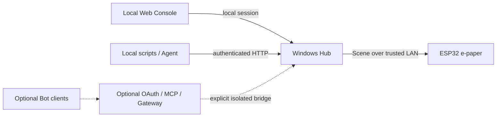

# Attention Router

[中文](README.md) | **English**

**v0.1.0 · Source release**

A local-first AI attention router powered by ESP32 e-paper, bringing tasks, work context, and important alerts into focus.

Attention Router brings tasks, work context, and authorized alerts to an ESP32 e-paper display. You can also run the Web Console by itself without hardware, a Bot or a model subscription. It is a physical attention interface for a Personal Agent: a place to see what you are working on and what needs a response. Routing currently uses deterministic rules; general Agent lifecycle management is not implemented.

Work can be scattered across browsers, editors, and Agent conversations. Home provides a small task view, Workspace keeps the current item visible, and Interrupt surfaces an authorized alert. Acknowledging an alert is separate from completing its Todo.

> **v0.1.0 is published as source; no precompiled firmware is supplied.** The [limited GitHub Actions checks passed](https://github.com/Tkkdy/attention-router/actions/runs/39403342507) for release baseline `3ba371af`. This is not full regression or final hardware acceptance. Acceptance of the exact public firmware and a hardware photograph remain outstanding; see [validation records](docs/VALIDATION.md).

## Real interface and architecture


This screenshot is rendered by a real browser against an isolated Hub from this candidate, using synthetic data and disabled foreground monitoring. It is not a mock interface and does not prove a connected device or hardware acceptance. A publishable, privacy-safe hardware photo is still missing; no concept image stands in for a product photograph. See the [asset index](assets/ASSET_INDEX.md) for provenance and privacy handling.



Solid lines represent the base path; dotted lines represent experimental integrations. Remote OAuth/MCP and the local Gateway are separately configured components, not a complete automatic installer. The device polls `/scene`. See the maintainable [architecture source](assets/architecture.mmd).

## Implemented core

**Implemented** means code and relevant software evidence exist. It does not mean every hardware behavior of the final candidate has been accepted.

| Capability | Actual behavior |
| --- | --- |
| Home / Workspace / Interrupt | Home and work views, with an authorized alert overlay; routing and optional page lifecycles determine the final page |
| Todo / Current / Next | Ordered tasks, an explicitly set current item, and next items excluding the current ID |
| Windows context | Foreground-application signals, session thresholds, and AUTO/CODING/IDLE/QUIET overrides |
| NOW / QUEUE / DIGEST / DROP | Show now, defer, retain without interruption, or withdraw attention; at most one NOW |
| Web Console and ACK | Inspect context, routes, tasks, events, and provenance; ACK does not complete a Todo |
| Local API and LAN Scene | Authenticated HTTP integration and a device Scene feed; Hub publication is distinct from device receipt |
| Disconnection handling | Approximately 90 seconds to fall back and 45 stable seconds before Hub takeover; STALE marks old data, with limited offline Chinese-title recovery |

**What Today means:** `TODAY` is a Home section label. It shows the first three `pending` Todos in their existing order, **without filtering by today's date or a due date**. Time passing does not complete a Todo. Workspace excludes Current by ID before selecting the first three next items; identical titles with different IDs remain different tasks. Some date adapters use UTC+8; timezone localization is incomplete.

**Routing is not an LLM summary.** Future events wait in QUEUE. Explicit reminders/current blockers can enter NOW. Awaited results wait during CODING/QUIET. Information without interrupt authorization goes to DIGEST. Acknowledged, cancelled, or expired events can become DROP. DIGEST is a stored routing category, not a finished automatic summarization feature.

## Experimental integrations and roadmap

These features have code but remain **Experimental**. None is required for the base installation:

- **GrokBot, MCP/OAuth:** local MCP reads and policy-controlled Todo/Current writes, remote OAuth libraries, Gateway integration, and client tool contracts. They require caller-owned accounts, credentials, and separate deployment; a clean standalone Bot installation has not been accepted end to end.
- **DeepSeekBot and natural-language Resolver:** adapters for external DS Bot/Harness; isolated Todo Core operations for create/update/complete/delete/reorder, Current, suggestions, and reminder bridging. The resolver uses the configured official DeepSeek online API, may incur charges, and sends relevant user input and business snapshots. It is not free local open-weight inference.
- **Todo Core, Gateway, and projection bridge:** separate task storage, revisions, and idempotency. Starting the Gateway does not automatically synchronize the base Hub and does not complete a production-data migration.
- **Codex quota:** optional reads of authenticated local Codex app-server quota snapshots. Disabled by the basic launcher; it does not observe task completion or approval states.
- **Tibo Reset:** optional community reset/forecast data and a device detail page. Disabled by default; automatic attention policy is unconfigured, and forecasts are not guaranteed resets.
- **Radar, weather, NTP, and Internet Probe:** optional external providers for the Hub/device. LAN Hub freshness and Internet reachability are separate signals.

The [full bilingual feature matrix and roadmap](docs/FEATURES.md) lists entry points, dependencies, cost conditions, and evidence boundaries. **Planned, not implemented:** ChatGPT web-response completion alerts; Codex completed/awaiting-approval/awaiting-acceptance alerts; an Agent Inbox; broader personal context and a Personal Agent attention assistant. No delivery dates are promised.

## Start on Windows

Use a new extracted directory and open PowerShell there. Historical software validation used Windows and Python 3.13.7. Install the included dependency lock:

```powershell
py -3.13 -m venv .venv
.\.venv\Scripts\python.exe -m pip install -r requirements.lock.txt
Copy-Item config.example.json config.local.json
.\.venv\Scripts\python.exe hub\run_preview.py
```

Open <http://127.0.0.1:8765/>. The default listener is loopback-only. No system service, domain, Tunnel, Bot, or model subscription is required. Data stays in this checkout's `.build/preview-data/`; do not copy an existing personal database into it. Stop the Hub with `Ctrl+C` in its own terminal. Running the same command again reuses that directory's data.

In another terminal, create synthetic sample tasks, Current, and an alert:

```powershell
.\.venv\Scripts\python.exe examples\local_demo.py
```

Click ACK in the Console and verify that the alert clears without completing its Todo. A manual CODING override supplies work context. AUTO normally requires 120 seconds of continuous strong signals to enter a work session and 900 seconds without strong signals to leave it. This does not detect whether an Agent has finished. The demonstration writes data and is intended for a new isolated installation.

### Connect an ordinary Agent

In a **fresh isolated installation**, add `--api-token-prompt` when starting the Hub and privately enter your own random 32+ character token. In another terminal, run:

```powershell
.\.venv\Scripts\python.exe examples\agent_http_demo.py
```

Enter the same token without echo. The example reads revisions, creates a synthetic Todo, links Current to its real ID, publishes an explicitly authorized synthetic reminder, and verifies ACK leaves the Todo pending. Transport retries retain the original request; a 409 re-reads revisions and stops. Only `127.0.0.1` is accepted; private port 8000 is rejected. See the [bilingual HTTP quickstart](docs/AGENTS.md#agent-http-quickstart) for both terminal commands. No GrokBot, DeepSeekBot, OAuth, Tunnel or paid model is required. The existing Cookie-based `local_demo.py` remains available.

`config.local.json` accepts `port`, `device_host`, and `monitor`. If the port is occupied, choose another one and add `--url http://127.0.0.1:YOUR_PORT` to the demo; do not terminate unrelated services. The [English installation guide](docs/INSTALL_EN.md) contains full toolchain steps and troubleshooting.

## Hardware and firmware

The initial hardware target is **classic ESP32, 4 MB Flash, GDEY042Z98 4.2-inch 400×300 black/white/red SSD1683 display**, with a compatible adapter. Other 4.2-inch panels are not interchangeable. Seeed XIAO ESP32S3 is future support. Exact board/adapter identity, power, wiring, and safe operation must still be verified for final hardware acceptance.

Read the self-contained [English hardware and installation guide](docs/INSTALL_EN.md) before wiring; it includes the pinout, unresolved adapter VCC checks, isolated toolchain setup, build/upload commands and troubleshooting. The ESP32 uses 3.3 V logic; the code cannot establish whether an adapter accepts a 5 V supply. Use Arduino CLI 1.5.1, ESP32 Core 3.3.1, GxEPD2 1.6.9, ArduinoJson 7.4.2, Adafruit GFX 1.12.6, and BusIO 1.17.4. The Windows guide creates a project-local toolchain configuration rather than changing a global Arduino installation.

Copy the example header and enter only your own test Wi-Fi and Hub settings:

```powershell
Copy-Item firmware/esp32_dashboard/private_config.example.h firmware/esp32_dashboard/private_config.h
# After installing the isolated toolchain as documented in docs/INSTALL_EN.md:
powershell -NoProfile -File .\compile_firmware.ps1 -ArduinoCli .\.build\toolchain\arduino-cli.exe -ConfigFile .\.build\toolchain\arduino-cli.yaml
```

This only compiles. Set `device_host` to the PC's specific private LAN IPv4 and use the matching IP/port in the firmware. Restart only your own isolated Hub. Firewall changes are manual and should be limited to the device source on a trusted LAN. Generated firmware may embed Wi-Fi credentials: never publish `.build`, `private_config.h`, or personal `.bin` files.

Use an owner-confirmed compatible test device for hardware trials. Before writing an existing device, verify rollback of the application and necessary data; **restoring the application alone does not restore NVS**. The original-board No-Go and detailed safety gates remain in the [hardware reference](docs/HARDWARE.md) and [English installation guide](docs/INSTALL_EN.md). Precompiled firmware awaits safe configuration and specified-hardware acceptance.

## Network, limitations, and evidence

- The local Console uses a local browser session and same-origin write checks. Anonymous LAN access is limited to `/scene` and `/health`, but Scene contains task information.
- `--api-token-prompt` accepts a caller-created token of at least 32 ASCII non-whitespace characters. A valid Bearer token also authorizes management APIs on a bound LAN listener; it is **not loopback-only**. HTTP does not encrypt it. Prefer local Agent calls and never expose the Hub, Gateway, or database directly through a public Tunnel.
- A private running version has shown disconnection fallback and automatic recovery. Its current exact firmware identity is UNKNOWN. The public candidate lacks a final exact-binary hardware acceptance record; long-term reliability is not established.
- A private device displayed ASCII `Todo <short ID>` fallback titles after an offline cold boot, then recovered readable titles online. NVS write failures also exist in historical evidence. The root cause is unresolved; this neither proves every default candidate fails nor guarantees lossless offline Chinese titles. Original-board diagnosis is frozen and can remain a follow-up Issue.
- Microsoft YaHei is not bundled. Without a usable font, Chinese title bitmaps fall back to ASCII. A successful `/scene` response is not proof of completed display refresh. Polling is approximately 30 seconds, with a 5-second HTTP read timeout; this is not an emergency alert system.
- Historical stability tests passed 9/9. Core regressions passed 86/88, retaining two legacy JSON-migration failures. Fresh data directories are the supported path. Injected long transactions can still time out business endpoints while health remains responsive.
- Device NTP/weather/Radar require a configured and successful Internet Probe. An empty probe URL prevents new corresponding acquisition. These services are not required for local Hub tasks; some time semantics remain UTC+8.

See [limitations](docs/LIMITATIONS.md), [validation](docs/VALIDATION.md), and [network boundaries](docs/NETWORK.md). Historical software or private hardware evidence does not replace final safe acceptance of core display, task updates, alerts/ACK, and disconnection recovery. These remain follow-up hardware checks and do not block this source release.

## Documentation, contribution, and licensing

- [中文 README](README.md) · [Full features and roadmap](docs/FEATURES.md)
- [Windows installation and hardware (English)](docs/INSTALL_EN.md) · [Chinese hardware reference](docs/HARDWARE.md)
- [Agent integration](docs/AGENTS.md) · [Networking](docs/NETWORK.md)
- [Limitations](docs/LIMITATIONS.md) · [Validation](docs/VALIDATION.md)
- [Contributing](CONTRIBUTING_EN.md) · [Release notes](RELEASE_NOTES.md)
- [License scope](docs/LICENSING.md) · [Third-party notices](THIRD_PARTY_NOTICES.md)

Issues and Pull Requests are welcome; Discussions are not enabled for launch. Public repository: [Tkkdy/attention-router](https://github.com/Tkkdy/attention-router).

Copyright (c) 2026 Tkkdy. Independent original Hub, Web Console, and tooling use **MIT**. Original ESP32 firmware uses **GPL-3.0-only**, with the applicable obligations of its combined dependencies. Third-party materials retain their licenses. Commercial use is allowed under the respective terms; the root MIT scope does not override firmware GPL obligations. The license files are authoritative.
